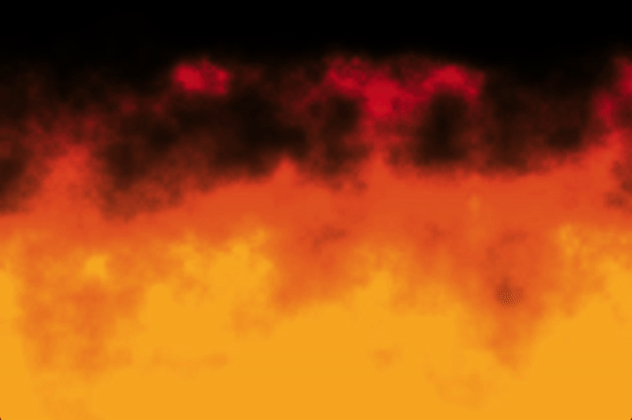

# Raylib Effects

A collection of various graphic effects made mostly with GLSL. 
The launcher was made in C#, using raylib as a graphics library.

I mostly made this just for fun, experimenting with various effects. Many of the effects were inspired by or adapted from shaders I found on shadertoy, or other sites, and modified into GLSL. I have provided credit in the description of each effect.

# Effects

## Plasma

This effect utilises layered sine waves with various colors to create a classic effect. Popular in many oldschool demos. Was a good option to start with, as lots of online resources.

<p align="center">
    
</p>

**Credits:**
- [Shadertoy](https://www.shadertoy.com/view/XsVSDz)
- [Lode's Computer Graphics Tutorial - Plasma](https://lodev.org/cgtutor/plasma.html)

## Ripple

This effect creates a pattern by measuring the distance of each pixel from the centre of the screen. It then utilises sine waves again, this time to animate the effect; creating the appearance of waves spreading across the image.

<p align="center">
    
</p>

**Credits**
- [Shadertoy](https://www.shadertoy.com/view/ldX3zr)

## Swirl

This effect creates an angle, based off the screen position. Sine waves are utilised again to create the repeating bands of color, with the angle distorted over time to produce the twisting motion. Similar to the ripple effect, but also quite different. 

<p align="center">
    
</p>

**Credits**
- [Shadertoy](https://www.shadertoy.com/view/3sBXDm)

## Starfield

This effect creates a layered starfield, using randomly positioned stars moving at different speeds. Having multiple layers gives the illusion of moving through space. 

<p align="center">
    
</p>

**Credits**
- [Shadertoy](https://www.shadertoy.com/view/tllfRX)

## Fire

This is a procedural fire effect created by combining multiple layers of noise. The noise is animated upwards, and shaped using a gradient to create the fire shape. Then various different colors are blended together to give the fire appearance.

<p align="center">
    
</p>

**Credits**
- [Shadertoy](https://www.shadertoy.com/view/3tcBzH)

## Tunnel

This effect creates a classic tunnel effect, commonly seen in old school demos, by converting each pixel into a distance from the centre and an angle around it. These values are then animated to give the illusion of movement, even without any actual 3D geometry.

<p align="center">
    
</p>

**Credits**
- [lodev](https://lodev.org/cgtutor/tunnel.html)

# Using the launcher

To use the effect launcher open a terminal in the effects folder.
Then use

```
dotnet run
```

To open the selection menu.
Or launch a specific effect directly by typing the effect name:

```
dotnet run -- plasma
```

# Other useful resources

https://thebookofshaders.com/01/
https://openglbook.com/chapter-0-preface-what-is-opengl.html
https://www.flipcode.com/archives/The_Art_of_Demomaking-Issue_01_Prologue.shtml
https://learnopengl.com/
https://www.4rknova.com/blog/2016/11/01/plasma
https://aarondevelops.com/game-engine-shaders-101/
https://lodev.org/cgtutor/ 